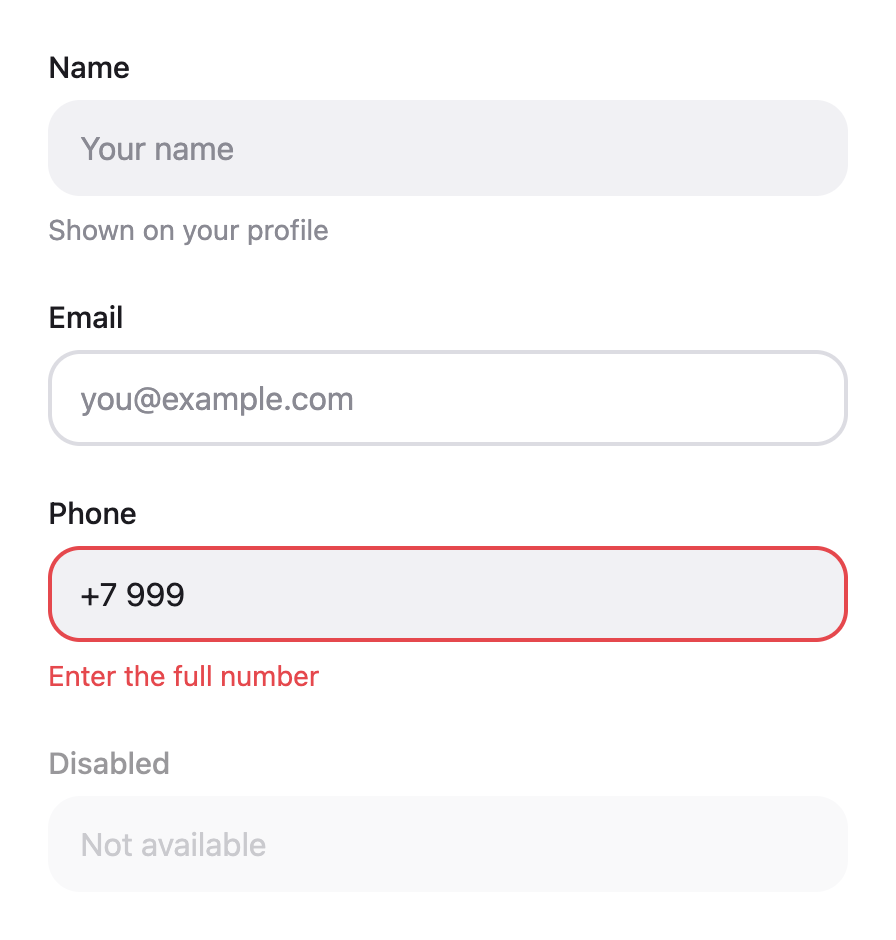
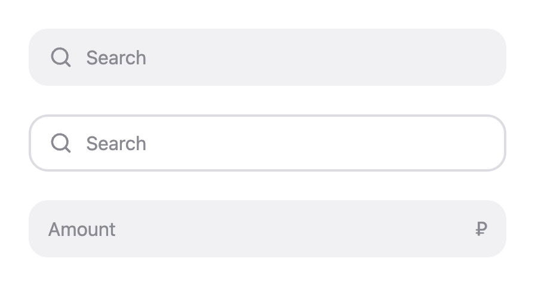
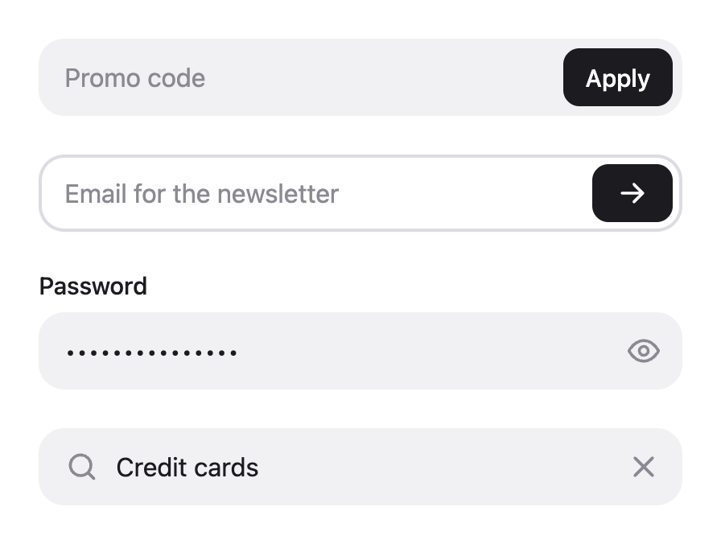
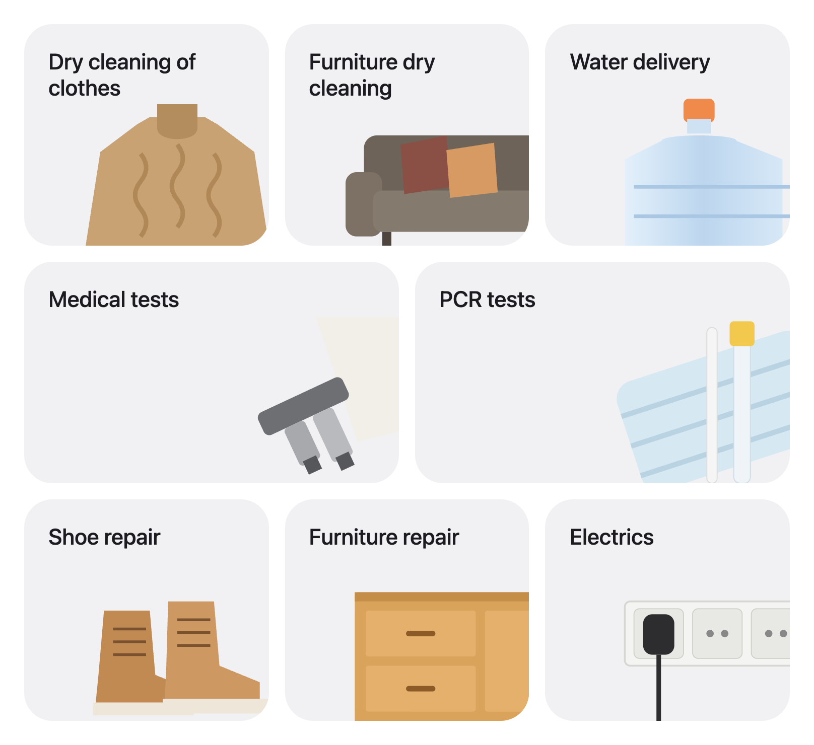
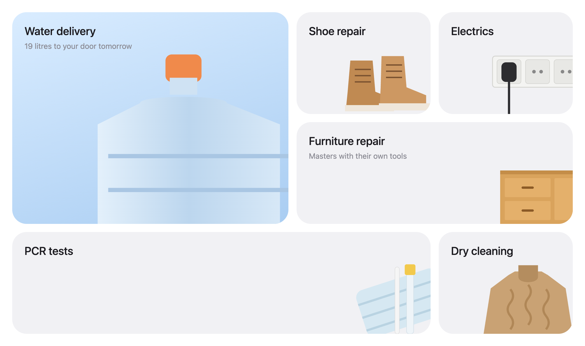

# varkeui

Библиотека React-компонентов. Лёгкая, без рантайм-зависимостей, стилизуется через CSS-переменные.

```bash
npm install varkeui
```

## Подключение

Стили подключаются один раз в корне приложения:

```tsx
import 'varkeui/styles.css';
```

Дальше компоненты импортируются напрямую:

```tsx
import { TileButton, PlusIcon } from 'varkeui';

export function Shortcuts() {
  return (
    <>
      <TileButton label="Credit" image="/img/flamingo.png" imagePosition="bottom" />
      <TileButton
        label="Family card"
        image="/img/card.png"
        imagePosition="bottom"
        variant="outlined"
        badge={<PlusIcon />}
        onClick={() => openFamilyCard()}
      />
    </>
  );
}
```

Работает с React 18 и 19, поставляется в ESM и CommonJS с типами.

## Темы

Из коробки есть светлая и тёмная темы. Тема задаётся атрибутом на любом элементе-предке, обычно на `<html>`:

```html
<html data-vui-theme="dark"></html>
```

Все цвета — CSS-переменные, их можно переопределить глобально или для отдельного блока:

```css
:root {
  --vui-color-bg: #1f1e23; /* фон страницы, им же закрашивается выемка под бейджем */
  --vui-color-surface: #2d2c32; /* фон плиток */
  --vui-color-surface-hover: #36353b;
  --vui-color-border: #3b3a40; /* обводка outlined-варианта */
  --vui-color-text: #ffffff;
  --vui-color-text-muted: #8e8d94;
  --vui-color-focus: #7aa0ff;
  --vui-color-accent: #ffffff; /* фон primary-кнопок */
  --vui-color-accent-hover: #e4e4e8;
  --vui-color-accent-text: #1c1b20;
  --vui-color-danger: #ff6369; /* ошибки */
  --vui-font-family: Inter, system-ui, sans-serif;
}
```

## Компоненты

### TileButton

Квадратная (или любая другая) плитка с картинкой внутри и подписью снизу. Подходит для быстрых действий, разделов, документов, адресов.

<picture>
  <source media="(prefers-color-scheme: dark)" srcset="docs/images/tile-button-dark.png" />
  
</picture>

| Проп            | Тип                                                       | По умолчанию | Описание                                                               |
| --------------- | --------------------------------------------------------- | ------------ | ---------------------------------------------------------------------- |
| `label`         | `ReactNode`                                               | —            | Подпись под плиткой                                                    |
| `image`         | `string \| ReactNode`                                     | —            | URL картинки или любой элемент: svg, иконка, ``                   |
| `imageAlt`      | `string`                                                  | `''`         | alt для картинки, если передан URL                                     |
| `imagePosition` | `center`, `top`, `bottom`, `left`, `right`, `top-left`, … | `center`     | Куда прижать картинку внутри плитки                                    |
| `imageSize`     | `string \| number`                                        | `100%`       | Размер картинки: `70%`, `96`, `6rem`                                   |
| `imageFit`      | `contain \| cover`                                        | `contain`    | `cover` растягивает картинку на всю плитку                             |
| `variant`       | `filled \| outlined`                                      | `filled`     | С фоном или с обводкой. Размер у обоих одинаковый — обводка внутренняя |
| `size`          | `sm \| md \| lg`                                          | `lg`         | 96, 128 и 160 px                                                       |
| `width`         | `string \| number`                                        | —            | Своя ширина, перебивает `size`                                         |
| `aspectRatio`   | `string \| number`                                        | `1`          | Соотношение сторон: `2.2`, `'16 / 9'`                                  |
| `radius`        | `string \| number`                                        | по `size`    | Скругление углов                                                       |
| `block`         | `boolean`                                                 | `false`      | Растянуть на ширину контейнера — удобно в гридах                       |
| `badge`         | `ReactNode`                                               | —            | Элемент в правом верхнем углу. Под ним вырезается выемка цвета фона    |
| `labelLines`    | `number`                                                  | `2`          | Сколько строк подписи показывать, остальное обрезается многоточием     |
| `href`          | `string`                                                  | —            | Если передан, плитка рендерится ссылкой `<a>`                          |

Остальные пропсы (`onClick`, `disabled`, `aria-*`, `className`, `style` и т. д.) уходят на корневой `<button>` или `<a>`. `ref` тоже пробрасывается.

Широкие плитки с картинкой на весь фон:

<picture>
  <source media="(prefers-color-scheme: dark)" srcset="docs/images/tile-button-wide-dark.png" />
  
</picture>

```tsx
<TileButton label="Home" image="/img/home-map.jpg" imageFit="cover" width={352} aspectRatio={2.2} />
```

Резиновая сетка:

```tsx
<div style={{ display: 'grid', gridTemplateColumns: 'repeat(3, 1fr)', gap: 16 }}>
  <TileButton block aspectRatio={2.2} imageFit="cover" label="Home" image={home} />
  <TileButton block aspectRatio={2.2} imageFit="cover" label="Work" image={work} />
  <TileButton block aspectRatio={2.2} imageFit="cover" label="Other" image={other} />
</div>
```

Если под плиткой не однотонный фон, цвет выемки задаётся отдельно:

```css
.my-section .vui-tile {
  --vui-tile-notch-color: #141317;
}
```

### List и ListItem

Пункт списка: иконка слева, заголовок и подзаголовок, справа — необязательный слот. `List` собирает пункты в `<ul>`.

<picture>
  <source media="(prefers-color-scheme: dark)" srcset="docs/images/list-dark.png" />
  
</picture>

```tsx
import { List, ListItem } from 'varkeui';

<List>
  <ListItem
    size="lg"
    icon="/img/shield.png"
    title="Protect your data"
    subtitle="Verified accounts with enabled face or fingerprint login can't be stolen"
  />
  <ListItem size="lg" icon="/img/heart.png" title="Add family members" subtitle="…" />
</List>;
```

Без `onClick` и `href` пункт — обычный блок. С `onClick` он становится кнопкой, с `href` — ссылкой, и подсвечивается при наведении:

<picture>
  <source media="(prefers-color-scheme: dark)" srcset="docs/images/list-interactive-dark.png" />
  
</picture>

```tsx
<List dividers>
  <ListItem
    icon={<UserIcon />}
    title="Personal data"
    subtitle="Name, phone number, email"
    after={<ChevronRightIcon />}
    onClick={openProfile}
  />
  <ListItem icon={<LockIcon />} title="Security" after={<ChevronRightIcon />} href="/security" />
</List>
```

| Проп            | Тип                   | По умолчанию | Описание                                                |
| --------------- | --------------------- | ------------ | ------------------------------------------------------- |
| `title`         | `ReactNode`           | —            | Заголовок                                               |
| `subtitle`      | `ReactNode`           | —            | Подзаголовок, приглушённым цветом                       |
| `icon`          | `string \| ReactNode` | —            | URL картинки или любой элемент                          |
| `iconSize`      | `string \| number`    | по `size`    | Сторона квадрата под иконку                             |
| `after`         | `ReactNode`           | —            | Правый слот: стрелка, переключатель, счётчик            |
| `size`          | `sm \| md \| lg`      | `md`         | Иконка 32 / 48 / 72 px и соответствующие размеры текста |
| `align`         | `center \| start`     | `center`     | Выравнивание иконки и правого слота по вертикали        |
| `titleLines`    | `number`              | `2`          | Максимум строк заголовка                                |
| `subtitleLines` | `number`              | `3`          | Максимум строк подзаголовка                             |
| `onClick`       | `function`            | —            | Делает пункт кнопкой                                    |
| `href`          | `string`              | —            | Делает пункт ссылкой                                    |
| `disabled`      | `boolean`             | `false`      | Для кликабельного пункта                                |

У `List` один собственный проп — `dividers`: тонкие линии между пунктами. Линия начинается от текста, а не от иконки, и прячется рядом с подсвеченным пунктом, чтобы не резать плашку наведения.

### Input и InputButton

Текстовое поле. Все нативные пропсы (`value`, `onChange`, `type`, `placeholder`, `name`…) и `ref` уходят на `<input>`, а `className` и `style` — на корневой элемент.

<picture>
  <source media="(prefers-color-scheme: dark)" srcset="docs/images/input-dark.png" />
  
</picture>

```tsx
import { Input } from 'varkeui';

<Input label="Name" placeholder="Alexey" hint="As in your passport" />
<Input label="Phone" value={phone} onChange={(e) => setPhone(e.target.value)} error="Enter the full number" />
```

С иконкой — `startIcon` и `endIcon`:

<picture>
  <source media="(prefers-color-scheme: dark)" srcset="docs/images/input-icon-dark.png" />
  
</picture>

```tsx
<Input type="search" placeholder="Search" startIcon={<SearchIcon />} />
```

С кнопкой — `action` и `InputButton`. Вариант `primary` — контрастная кнопка, `ghost` — без фона, для иконок:

<picture>
  <source media="(prefers-color-scheme: dark)" srcset="docs/images/input-button-dark.png" />
  
</picture>

```tsx
<Input placeholder="Promo code" action={<InputButton onClick={apply}>Apply</InputButton>} />

<Input
  type={visible ? 'text' : 'password'}
  action={
    <InputButton variant="ghost" aria-label="Show password" onClick={toggle}>
      {visible ? <EyeOffIcon /> : <EyeIcon />}
    </InputButton>
  }
/>
```

| Проп        | Тип                  | По умолчанию | Описание                                     |
| ----------- | -------------------- | ------------ | -------------------------------------------- |
| `label`     | `ReactNode`          | —            | Подпись над полем, связана с `<input>`       |
| `hint`      | `ReactNode`          | —            | Подсказка под полем                          |
| `error`     | `ReactNode`          | —            | Текст ошибки: красная рамка, заменяет `hint` |
| `invalid`   | `boolean`            | `false`      | Красная рамка без текста                     |
| `startIcon` | `ReactNode`          | —            | Иконка слева                                 |
| `endIcon`   | `ReactNode`          | —            | Иконка справа                                |
| `action`    | `ReactNode`          | —            | Кнопка внутри поля справа                    |
| `size`      | `sm \| md \| lg`     | `md`         | Высота 40 / 48 / 56 px                       |
| `variant`   | `filled \| outlined` | `filled`     | С фоном или с обводкой                       |
| `block`     | `boolean`            | `false`      | Растянуть на ширину контейнера               |

### BentoGrid и BentoCard

Бенто-сетка из карточек с заголовком и картинкой. Сетка задаёт колонки, карточка — сколько колонок и строк она занимает.

<picture>
  <source media="(prefers-color-scheme: dark)" srcset="docs/images/bento-dark.png" />
  
</picture>

```tsx
import { BentoCard, BentoGrid } from 'varkeui';

<BentoGrid columns={6} rowHeight={220}>
  <BentoCard href="/cleaning" title="Dry cleaning of clothes" image={sweater} colSpan={2} />
  <BentoCard href="/furniture" title="Furniture dry cleaning" image={sofa} colSpan={2} />
  <BentoCard href="/water" title="Water delivery" image={bottle} colSpan={2} />
  <BentoCard href="/medical" title="Medical tests" image={microscope} colSpan={3} />
  <BentoCard href="/pcr" title="PCR tests" image={mask} colSpan={3} />
</BentoGrid>;
```

**Адаптивность.** `columns`, `rowHeight`, `colSpan` и `rowSpan` принимают число или объект по брейкпоинтам. Брейкпоинты `sm` / `md` / `lg` — 640 / 768 / 1024 px, и считаются они от ширины самой сетки, а не окна: сетка в узкой боковой колонке ведёт себя как на телефоне. Если `colSpan` больше числа колонок, карточка просто растягивается на всю ширину.

```tsx
<BentoGrid columns={{ base: 2, sm: 6 }} rowHeight={{ base: 180, sm: 220 }}>
  <BentoCard title="Medical tests" colSpan={{ base: 1, sm: 3 }} />
</BentoGrid>
```

Большие карточки, градиенты, `dense`, чтобы короткие карточки заполняли дырки:

<picture>
  <source media="(prefers-color-scheme: dark)" srcset="docs/images/bento-classic-dark.png" />
  
</picture>

```tsx
<BentoGrid columns={{ base: 1, sm: 2, lg: 4 }} rowHeight={200} dense>
  <BentoCard
    href="/water"
    title="Water delivery"
    description="19 litres to your door tomorrow"
    image={bottle}
    colSpan={{ sm: 2 }}
    rowSpan={2}
    background="linear-gradient(160deg, #d9ecff, #a9cdf2)"
  />
  …
</BentoGrid>
```

**Клики и ссылки.** С `href` карточка — `<a>`, с `onClick` — `<button>`, без них — просто блок. Для роутеров передай компонент ссылки в `as`, его пропсы типизируются:

```tsx
import { Link } from 'react-router';

<BentoCard as={Link} to="/water" title="Water delivery" image={bottle} />;
```

`BentoGrid`:

| Проп        | Тип                            | По умолчанию | Описание                                   |
| ----------- | ------------------------------ | ------------ | ------------------------------------------ |
| `columns`   | `Responsive<number>`           | `2`          | Число колонок                              |
| `rowHeight` | `Responsive<string \| number>` | `200`        | Высота строки, можно `'auto'`              |
| `gap`       | `string \| number`             | `16`         | Отступ между карточками                    |
| `dense`     | `boolean`                      | `false`      | Заполнять дырки карточками, идущими дальше |

`BentoCard`:

| Проп               | Тип                   | По умолчанию   | Описание                                  |
| ------------------ | --------------------- | -------------- | ----------------------------------------- |
| `title`            | `ReactNode`           | —              | Заголовок в левом верхнем углу            |
| `description`      | `ReactNode`           | —              | Текст под заголовком                      |
| `image`            | `string \| ReactNode` | —              | URL картинки или любой элемент            |
| `imagePosition`    | как у `TileButton`    | `bottom-right` | К какому краю или углу прижать картинку   |
| `imageSize`        | `string \| number`    | `70%`          | Размер области под картинку               |
| `imageFit`         | `contain \| cover`    | `contain`      | `cover` — картинка на весь фон            |
| `colSpan`          | `Responsive<number>`  | `1`            | Сколько колонок занимает                  |
| `rowSpan`          | `Responsive<number>`  | `1`            | Сколько строк занимает                    |
| `background`       | `string`              | —              | Цвет, градиент или `url(...)`             |
| `href` / `onClick` |                       | —              | Ссылка или кнопка                         |
| `as`               | `ElementType`         | —              | Свой компонент для корня, например `Link` |
| `disabled`         | `boolean`             | `false`        | Неактивная карточка                       |

`Responsive<T>` — это `T` или `{ base?: T; sm?: T; md?: T; lg?: T }`.

### Иконки

`PlusIcon`, `ChevronRightIcon`, `ArrowRightIcon`, `SearchIcon`, `CloseIcon`, `EyeIcon`, `EyeOffIcon` — простые SVG, берут цвет из `currentColor`.

## Разработка

Нужен Node.js 24 (версия лежит в `.nvmrc`).

```bash
npm install
npm run dev          # Storybook на http://localhost:6006
```

| Команда                   | Что делает                                       |
| ------------------------- | ------------------------------------------------ |
| `npm run dev`             | Storybook с живой перезагрузкой                  |
| `npm test`                | Тесты (Vitest + Testing Library)                 |
| `npm run test:watch`      | Тесты в watch-режиме                             |
| `npm run lint`            | ESLint                                           |
| `npm run format`          | Prettier по всему проекту                        |
| `npm run typecheck`       | Проверка типов                                   |
| `npm run build`           | Сборка библиотеки в `dist/`                      |
| `npm run build:storybook` | Статическая сборка Storybook                     |
| `npm run screenshots`     | Пересобрать картинки для README в `docs/images/` |
| `npm run check`           | Всё сразу — то же, что гоняет CI                 |
| `npm run changeset`       | Описать изменение для следующего релиза          |

### Структура

```
scripts/screenshots.mjs      снимает скриншоты сторис для README
docs/images/                 эти скриншоты
src/
  components/
    TileButton/
      TileButton.tsx          компонент
      TileButton.css          стили
      TileButton.stories.tsx  сторисы
      TileButton.test.tsx     тесты
      index.ts
  icons/                      иконки
  styles/
    tokens.css                цвета, шрифты, темы
    index.css                 собирает все стили в dist/styles.css
  index.ts                    публичные экспорты
```

### Как добавить компонент

1. Создать папку `src/components/Name/` по образцу `TileButton`.
2. Классы — с префиксом `vui-`, цвета — только через переменные из `tokens.css`.
3. Подключить CSS в `src/styles/index.css`, экспорт — в `src/index.ts`.
4. Написать сторис и тесты.
5. Добавить историю в `scripts/screenshots.mjs`, запустить `npm run screenshots` и вставить картинку в README.
6. `npm run changeset` — выбрать `minor` для нового компонента, `patch` для фикса.

### Релизы

Версионирование через [Changesets](https://github.com/changesets/changesets).

1. В каждом PR с изменениями в библиотеке лежит changeset-файл (`npm run changeset`).
2. После мержа в `main` бот открывает PR «Release» — в нём поднятая версия и CHANGELOG.
3. Мерж этого PR публикует пакет в npm, ставит git-тег и создаёт GitHub Release.

Публикация идёт через [trusted publishing](https://docs.npmjs.com/trusted-publishers): npm доверяет workflow `release.yml` из этого репозитория, поэтому токены и секреты не нужны. Настройка на стороне npm — в Settings пакета → Trusted Publisher. Право на публикацию (`id-token: write`) есть только у job'а `publish`.

## Лицензия

MIT
